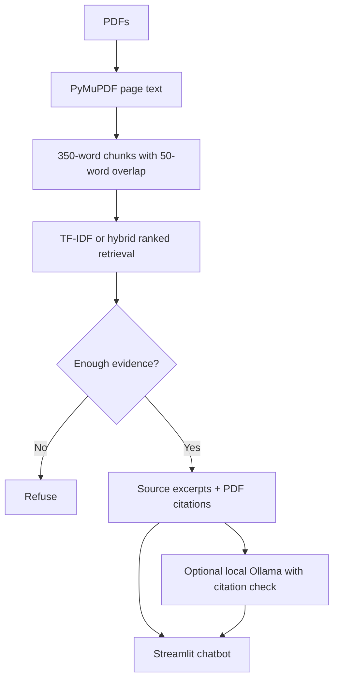

# Ask the Catalog — Group 5

**MSDS 630 NLP Residency Hackathon · October 9–11, 2026**

An **offline-capable, source-grounded Python chatbot** for academic-policy PDFs.
Search with TF-IDF or hybrid TF-IDF, see verbatim evidence and PDF page numbers,
and receive an explicit refusal when the system lacks adequate evidence. Optional
local embeddings and Ollama generation work after pre-download. The UI uses
Streamlit; CLI, evaluation scripts, tests, presentation, and report are included.

> **Provisional source notice:** The packaged data consists of **six
> project-created PDFs from official, public University of the Cumberlands
> webpages**, captured October 9, 2026. These are **not university-issued
> catalog/handbook PDFs** and are **not known to be professor-approved**.
> The 2026–27 catalog host returned HTTP 403, and the handbook required access.
> This academic prototype is not an official advising service. Do not treat
> excerpts, especially F-1/visa information, as current individual advice.

## What is complete

| Workstream | Deliverables | Status |
|---|---|---|
| 1 · Integration | App, CLI, package structure, README, tests | Done |
| 2 · Data | Six dated PDF snapshots, URL provenance, extraction / 350+50 page-bound chunks | Done; instructor approval still required |
| 3 · Modeling | Word TF-IDF, hybrid word/character retriever, calibrated thresholds, grounded source excerpts, optional embeddings/Ollama | Done |
| 4 · Evaluation | 25 verified source-backed QA entries, 5 unanswerable QA entries, 8 calibration items, benchmark outputs, evidence audit, error log | Done; independent student semantic audit required |
| 5 · Product | Streamlit UI, chat/refusal demo, citation drilldown, 10-slide deck and one-page technical report | Done |

The project was generated/tested with AI assistance. **Do not claim all five
students have personally implemented or independently validated every component.**
Each teammate should review, rehearse, and take responsibility for their part.

## Quick start

Requires Python 3.10+ and dependencies installed once while online.

```bash
python3 -m venv .venv
source .venv/bin/activate  # Windows: .venv\Scripts\activate
python -m pip install -r requirements-dev.txt
python -m pytest -q
streamlit run app.py
```

Select **University document index**, **hybrid** and **Offline source excerpts**;
the app loads `data/processed/chunks.json` from the six snapshot PDFs. A visible
warning identifies the source status. Select **Synthetic demo (fictional)** to
try fully invented policies; those are never UC policies.

Good offline demo questions:

1. `Which service processes official transcript orders?` — grounded source answer.
2. `By when must I apply for degree completion?` — two related deadlines.
3. `Will my personal accommodation request definitely be approved next year?` — refusal.

Terminal demo:

```bash
python -m catalog_rag.cli ask --retriever hybrid --threshold 0.118 \
  --question "Which service processes official transcript orders?"
```

The startup never silently replaces missing real document data with synthetic
demo data. If the extracted index is absent, you must ingest PDFs explicitly.

## Replacing snapshots with professor-approved PDFs

1. Obtain instructor approval, the actual 2026–27 Graduate Catalog, Student
   Handbook, or other designated PDFs. Track title, edition/year, URL and date.
2. Move the six snapshot PDFs **out of** `data/raw_pdfs/` so old/unapproved
   sources cannot silently mix with the new set. Then place approved PDFs there.
3. Build the page-bound chunk index:

```bash
python -m catalog_rag.cli ingest --input data/raw_pdfs \
  --output data/processed/chunks.json --chunk-words 350 --overlap-words 50
```

4. Create a **new** 30-question gold set for those documents; do not reuse the
   snapshot pages or answers. Work from `evaluation/questions_template.csv`.
   Freeze it *before* retrieval development; calibrate on a separate set.
5. Rerun evaluation and personally inspect output / scanned pages / tables.

The citations use the **one-based PDF page number**, not necessarily the page
number printed inside the catalog. Text extraction is PyMuPDF; scanned pages
require OCR, which this MVP does not include. Source provenance:
[`data/SOURCE_PROVENANCE.md`](data/SOURCE_PROVENANCE.md).

## Architecture



Offline mode is *extractive* and presents selected source sentences verbatim.
The final response shows up to five cited passages; the app also lets a reviewer
expand each full retrieved chunk. Its optional Ollama mode instructs a locally
running model to answer only from source context, requires valid `[S1]`–`[S5]`
IDs, and falls back to extractive excerpts if Ollama is unavailable/uncited.
Citation syntax by itself **does not guarantee a correct answer**.

Retrieval options: `tfidf` uses word 1–2 grams; `hybrid` uses 70% word TF-IDF and
30% character n-gram TF-IDF with cosine scores. For optional dense embeddings:

```bash
python -m pip install -r requirements-optional.txt
python -m catalog_rag.cli ask --retriever embeddings \
  --model sentence-transformers/all-MiniLM-L6-v2 --allow-download \
  --threshold 0.35 --question "What is the graduate transfer-credit limit?"
```

Download the model **before** going offline. Thresholds differ across methods;
0.35 is an unvalidated embedding example, not a benchmark result. For local
Ollama, install Ollama, `ollama pull llama3.2`, start its local service, then
pass `--mode ollama --ollama-model llama3.2` (or select it in the UI). No cloud
text-generation API key is required.

## Evaluation: actual provisional-corpus measurements

`evaluation/questions.csv`: 25 answerable + 5 unanswerable with 25 gold
document/page/answer/evidence-phrase entries. `evaluation/calibration_questions.csv`:
8 separate development examples; thresholds 0.095 word TF-IDF, 0.118 hybrid.
The evaluated 30 questions were **not a pristine held-out set**, because early
baseline errors informed later feature changes. These numbers are development
results, *not* independent future performance estimates.

| Metric | First TF-IDF baseline | Calibrated TF-IDF | Final hybrid |
|---|---:|---:|---:|
| Gold passage Recall@1 (25) | 18/25 (72%) | 18/25 (72%) | 16/25 (64%) |
| Gold passage Recall@5 (25) | 23/25 (92%) | 23/25 (92%) | **24/25 (96%)** |
| Correct refusals (5) | 3/5 | 5/5 | **5/5** |
| False refusals (25) | 2/25 | 0/25 | **0/25** |
| Mean reciprocal rank | 0.790 | 0.790 | 0.755 |

Passage Recall@5 requires **same PDF + same one-based PDF page + literal gold
evidence phrase in a top-five retrieved chunk**; just retrieving an unrelated
passage on the same page is not enough. The final source-quote audit measured
**24/25** gold phrases displayed to users. This is an *objective phrase-presence
check*, not an estimate of semantic answer accuracy or citation faithfulness.
Human judgment columns in the CSV are intentionally blank. The missing
case is Q10 (`INTR599`, true PDF p.4), whose source chunk ranked below top five.
The hybrid improves Recall@5 but **reduces Recall@1**. Seventeen pytest tests pass.

Reproduce:

```bash
python -m catalog_rag.cli validate-eval --questions evaluation/questions.csv
python -m scripts.calibrate --retriever hybrid \
  --output evaluation/results/calibration_hybrid.json
python -m catalog_rag.cli evaluate --retriever hybrid --threshold 0.118 \
  --questions evaluation/questions.csv \
  --output-prefix evaluation/results/official_web_hybrid_final
python -m scripts.audit_evidence --retriever hybrid --threshold 0.118
python -m pytest -q
```

Full observed error analysis, limitations, and method notes are in
[`docs/TECHNICAL_SUMMARY.md`](docs/TECHNICAL_SUMMARY.md). The 30 question
results with full answer text are in
`evaluation/results/official_web_hybrid_final_details.csv`; manual columns
remain for the students' independent review.

## Five-person presentation and handoff

| Speaker | Slides | Talk track |
|---|---|---|
| Member 1, Venkat | 1–2 | Problem, success criteria, honest prototype scope |
| Member 2, Data | 3–4 | Six public pages, snapshot limitations, 39 pages / 74 chunks |
| Member 3, Model | 5–6 | TF-IDF vs hybrid, local grounding, refusal logic |
| Member 5, UI | 7–8 | Live cited question, live refusal + terminal fallback |
| Member 4, Evaluation | 9–10 | 30 QA, Recall@5 tradeoff, error cases, ethics / next work |

Presentation: `presentation/Group5_Ask_the_Catalog_FINAL.pptx`, one-page PDF:
`docs/Group5_Technical_Summary.pdf`, run-through:
`presentation/DEMO_SCRIPT.md`, ownership: `team/OWNERSHIP.md`.

The project was produced and tested using ChatGPT/Codex assistance for code,
sources, labeling draft, automated comparisons, documentation, and slides.
The team must independently inspect each source and grade factual correctness,
seek professor approval for corpus, and be able to explain every submitted
artifact. Do not represent AI-based quote validation as faculty/student review.

## Final pre-submission checklist

- [x] Code, UI, CLI, source ingestion, optional local RAG features.
- [x] Six transparent provisional official-webpage snapshot PDFs.
- [x] 25 source-grounded + 5 unanswerable QA records and separated calibration.
- [x] Reproducible hybrid evaluation and structured errors.
- [x] Seventeen tests passed, citation/refusal demo commands ready.
- [x] Technical report and ten-slide PowerPoint.
- [ ] **Professor approves the sources, or replace them and rerun the full benchmark.**
- [ ] **All five students independently verify source/answer labels and manually audit output.**
- [ ] Check the exact deadline, practice ten-minute talk, and submit files/repository.
